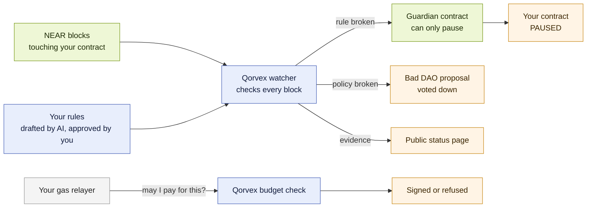
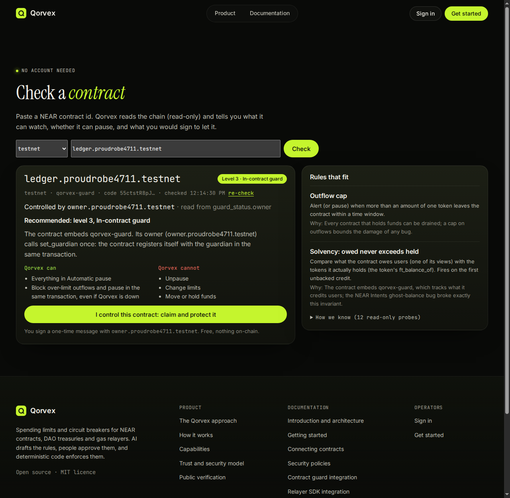

# Qorvex

**An automatic brake for NEAR contracts, DAO treasuries and gas relayers.**

Most DeFi money is now lost because contracts get their own math wrong (89% of 2025 losses, per Immunefi). And of the hacked protocols that had a pause button, almost none pressed it in time. Qorvex checks the rules a protocol must never break on every block, and the moment one breaks it pauses the contract on-chain, with a key that can do nothing except pause.

**[Live app](https://qorvexbackend-production.up.railway.app)** · **[Guardian contract on testnet](https://testnet.nearblocks.io/address/guardian.proudrobe4711.testnet)** · **[Try it in 3 minutes](#try-it)** · **[Integrate](#integrate)**


<sub>A ledger paused four blocks (about 3 s) after its books stopped adding up, with the reads that prove it, the pause transaction and the steps to recover.</sub>

---

## What exists and where

| | |
|---|---|
| **Hosted app** (NEAR testnet) | https://qorvexbackend-production.up.railway.app |
| **Guardian contract** | [`guardian.proudrobe4711.testnet`](https://testnet.nearblocks.io/address/guardian.proudrobe4711.testnet) |
| **Protected demo ledger** (embeds `qorvex-guard`) | [`ledger.proudrobe4711.testnet`](https://testnet.nearblocks.io/address/ledger.proudrobe4711.testnet) |
| **Demo token** (NEP-141) | [`usdc.proudrobe4711.testnet`](https://testnet.nearblocks.io/address/usdc.proudrobe4711.testnet) |
| **Guardian authorised on the ledger** | [`2LyBZhfH…c2zs`](https://testnet.nearblocks.io/txns/2LyBZhfHiPp1um43JwMS1ZTe7bx5xY8QnZm2c7Vmc2zs) |
| **Docs** (in the app) | [`/docs`](https://qorvexbackend-production.up.railway.app/docs) |
| **Code** | [`contracts/guardian`](contracts/guardian) · [`contracts/qorvex-guard`](contracts/qorvex-guard) (Rust crate) · [`sdk/`](sdk) (relayer SDK) · [`backend/`](backend) · [`frontend/`](frontend) |

To check the guardian's registration of the ledger yourself, call `get_target({"target":"ledger.proudrobe4711.testnet"})` on the guardian. It returns adapter `QorvexGuard`, council `owner.proudrobe4711.testnet` and scope `ALL`.

## How it works



<sub>Green: on NEAR · Blue: Qorvex · Orange: the outcome</sub>

1. **You state what must always hold**, for example "the ledger never owes users more USDC than it holds". The AI reads your contract and drafts these rules; each draft is checked against live chain state and backtested, and your team approves it.
2. **Every block that touches your contract**, the watcher checks the rules, then confirms any breach with a second read.
3. **On a confirmed breach** it calls `pause` on the guardian contract, and the guardian pauses your contract. Qorvex's key is a NEAR function-call key that can only call `pause`: it cannot unpause, change limits or move funds.
4. **The same engine guards other money**:
   - DAO treasuries get a voter that can only vote to reject proposals that break their policy.
   - Gas relayers ask Qorvex before paying for a user's transaction.
   - Depositors get a public status page backed by the same reads.

## Try it

**On the hosted app, nothing to install (about 3 minutes):**

| Do | See |
|---|---|
| Open the [app](https://qorvexbackend-production.up.railway.app), press **Get started**, enter `ledger.proudrobe4711.testnet`, press **Check** | Embeds qorvex-guard, **registered with the guardian (level 3)**, controlled by `owner.proudrobe4711.testnet`. Expand **How we know** for every read |
| **Sign in → Email → Create an account**, then **Create workspace** | The console: Overview, Contracts, Relayers, Team |
| **Relayers → Add relayer**, then **Set the budget → Use the gas-sponsor template** | A relayer token (shown once), an SDK snippet, and a budget of 1 NEAR and 10 storage deposits per beneficiary per day |

**Watch it stop an exploit, on a local NEAR sandbox (about 5 minutes):**

```bash
npm ci
npm run demo -- --auto --exit
```

This runs the whole scenario and prints a summary. It replays two real-world bug patterns against demo contracts:
- a ledger that keeps a credit after the deposit was refunded;
- a gas sponsor drained through `storage_deposit` calls.

To click through it instead, run `npm run demo` and open `http://localhost:8787/sign-in` with the operator token it prints:
1. **Contracts → Add a contract** → `sandbox` → `ledger.test.near` → **Check** → **I control this contract: claim and protect it**.
2. **Rules → Load demo source → Draft rules with AI**, then **Approve: alert + auto-pause** on the solvency rule.
3. **Setup → Sign with the sandbox owner key**.
4. **Simulations → Run the exploit as Mallory**: the contract shows **PAUSED** a few blocks later, and **Mallory tries to cash out** is rejected.

Requires Node.js 22 or newer. The first run downloads the NEAR sandbox binary (about 90 MB).

## Screens

| | |
|---|---|
| <br>**Contract check.** Paste any contract ID: what Qorvex can watch, whether it can pause, who controls it | <br>**Rules.** AI drafts with live values and backtests, approved by the team |
| <br>**Relayer budgets.** 92 of 100 drain attempts refused, each with its reason | <br>**Public status page.** A plain summary first, the raw reads one click away |

## Evidence

| Suite | Command | Result |
|---|---|---|
| Backend unit + frontend + build | `npm run check` | 103 + 32 tests pass |
| End-to-end on a local NEAR sandbox | `npm run test:e2e` | 16 tests pass |
| Contracts (needs Rust) | `npm run test:contracts` | 48 tests pass (guardian 28, qorvex-guard 13, demo ledger 7) |

All suites were run on a fresh clone on 2026-11-13. Among other things they cover:
- every workspace route called by a user from another workspace;
- NEAR wallet sign-in with real ed25519 keys and replayed nonces;
- relayer budgets under concurrent requests;
- the watcher key being unable to call anything except `pause`.

Output of `npm run demo -- --auto --exit`:

```text
watcher: breach at block 170, ledger paused at block 174 = 4 blocks later, 3.0 s after detection
vault paused in the deposit transaction itself: self-accounting: credited 290000000000 > backing 250000000000
with Qorvex check(): sponsored 8, refused 92, sponsor balance 0.6 NEAR -> 0.50347 NEAR
Qorvex voted VoteReject 3 blocks after submission -> proposal Rejected
Qorvex holds one key: function-call, receiver guardian.test.near, methods ["pause"].
```

## Integrate

Paste your contract ID into the app first. It reads the chain and tells you which path below applies and exactly what you'll sign. Every path starts with one signed message from the account that controls the contract; this proves ownership and costs nothing.

**A protocol whose contract holds funds**

| Your contract | What you do |
|---|---|
| Uses **near-plugins `Pausable`** | No code change. Sign two transactions from the console: grant the guardian the pause role (`acl_grant_role`), then register with the guardian (0.05 NEAR storage) |
| Is new or upgradable | Add the [`qorvex-guard`](contracts/qorvex-guard) crate and call its hooks on deposits, credits and withdrawals, then call `set_guardian` once. You also get per-token outflow caps, and the contract pauses itself inside the same transaction if its own books break. [`contracts/demo-ledger`](contracts/demo-ledger/src/lib.rs) is a worked example |
| Is owned by a DAO | The console turns the same calls into one DAO proposal for the council to approve |
| Has its own pause method | Sign one transaction as the contract account that registers the method with the guardian; the method must accept calls from the guardian |
| Has no pause method | Qorvex watches and alerts, with a ready-to-sign pause transaction in every alert |

Then approve rules (alert only, or alert + auto-pause) and publish the status page.

**A DAO treasury (Sputnik DAO, Trezu)**
- The council approves one proposal that adds a role whose only permission is to vote to reject transfer and function-call proposals.
- Qorvex is the role's only member.
- From then on, any proposal that breaks your policy (over the amount cap, a contract not on your list, too many actions) gets a reject vote within a few blocks.

**A gas relayer or sponsor**

```bash
npm install @qorvex/relayer-sdk
```

```ts
import { Qorvex } from "@qorvex/relayer-sdk";

const qorvex = new Qorvex({ url: QORVEX_URL, relayerId: RELAYER_ID, token: RELAYER_TOKEN });

const d = await qorvex.check({ beneficiary: daoId, action: "storage_deposit", cost: depositYocto, receiver: tokenId });
if (!d.allow) return refuse(d.reason);   // e.g. "count cap: 10 storage_deposit already sponsored for x.sputnik-dao.near in 86400s"
await signAndSend();
```

Budgets live on the server, so every instance of your relayer shares one spend history. If Qorvex is unreachable, `check()` refuses, unless you choose to allow small amounts up to a local cap. More in [`sdk/README.md`](sdk/README.md) and on [npm](https://www.npmjs.com/package/@qorvex/relayer-sdk).

## Why NEAR

- **NEAR makes the brake safe to hand over.** NEAR keys can be limited at the protocol level to one method on one contract. Qorvex's key can call `guardian.pause` and nothing else. On chains where a key can do everything its account can, the same guarantee needs a smart-contract wallet in front of it.
- **NEAR needs the brake to live outside the contract.** Cross-contract calls on NEAR are asynchronous: a contract can credit a user before it learns that the tokens were refunded. It cannot check its real balances inside one transaction, so a watcher has to check them across blocks.
- **The pieces already exist on NEAR:**
  - near-plugins `Pausable` gives Qorvex a standard pause to call.
  - Sputnik DAO's per-role voting lets a role vote only "reject".
  - NEP-413 lets users sign in with their NEAR wallet.
  - NEAR AI Cloud runs the AI with private inference in TEEs.

## Integrations

| Integration | Used for |
|---|---|
| **NEAR AI Cloud** (`Qwen/Qwen3.8-27B`, `Qwen/Qwen3.6-35B-A3B-FP8`) | Drafting rules from a contract's code and state; explaining incidents after a pause |
| **Sputnik DAO v2.3.1** | Reject-only firewall role; DAO-signed guardian authorisation |
| **near-plugins** (`Pausable`, ACL) | Pausing existing contracts without code changes |
| **NEAR Connect** by HOT (`@hot-labs/near-connect`) | Wallet sign-in (NEP-413) and signing transactions |
| **near-kit** | Transactions, signature checks, the local sandbox |
| **neardata.xyz**, FastNEAR and other public RPCs | Block stream, reads, archival backtests |
| **Better Auth** | Accounts, workspaces and roles, API keys |
| **Telegram, webhooks** | Incident alerts |
| **Railway** | Hosting |

Stack: Rust with near-sdk 5.29 for the contracts, Node.js 22+ and TypeScript for the backend, React 19 with Vite for the frontend, and SQLite for storage.

## Run your own

```bash
git clone https://github.com/Jayy4rl/Qorvex.git && cd Qorvex
npm ci
cp .env.example .env                     # every setting is documented in this file
QORVEX_NETWORKS=testnet npm start        # app and API on http://localhost:8787
```

| Command | What it does |
|---|---|
| `npm run deploy:testnet` | Deploys the guardian, demo token and ledger to testnet. It prints the plan and cost first (about 7.4 testnet NEAR, mostly refundable storage); `--yes` signs |
| `npm run dev:web` | Frontend with hot reload on :5173 |
| `npm run build:contracts` | Rebuilds the wasm (needs Rust and cargo-near); built wasm is committed in [`contracts/wasm/`](contracts/wasm) |

The hosted app is one Railway service built from the [`Dockerfile`](Dockerfile), with a volume at `/data`. Secrets come from environment variables only.

## Scope and roadmap

- **Pause speed:** 4 blocks (about 3 s) from the breaking block to the pause, measured on the local sandbox. The target is 3 blocks, which needs a NEAR Indexer node instead of polling the block stream.
- **Single server:** one watcher per network serves all workspaces.
- **Alerts:** each workspace sets its own Telegram chat and signed webhook (Team page); webhooks must be public https addresses.
- **Email:** invitations are shared as links.
- **Next:** several watchers that must agree before pausing, watchers running in a TEE, an embeddable status badge, billing.

## Hackathon notes

- Built at NEAR HACKATHON, November 2026. Tracks: `security`, `defi`, `social`.
- All code was written during the hackathon window; the first commit is dated 2026-11-10. NEAR only, no other chains.
- Libraries are listed above, with exact versions in each `package.json` and `Cargo.toml`. The code was written with Claude Code, an AI coding assistant.
- Other hackathon project by the same team: **[OTHER PROJECT NAME] — [OTHER PROJECT URL]**

MIT licensed, see [LICENSE](LICENSE).
