<div align="center">

# Qorvex

**Spending limits and circuit breakers for NEAR.**
Qorvex watches contracts, DAO treasuries and gas relayers, and stops the money flow within seconds when their books stop adding up, using a key that can only pause.

[](https://qorvexbackend-production.up.railway.app)


[](LICENSE)

**[Live demo](https://qorvexbackend-production.up.railway.app)** · **[Quick evaluation](#5-quick-evaluation-guide)** · **[Architecture](#6-architecture)** · **[Run it locally](#8-getting-started)**

Built at NEAR HACKATHON (November 2026) · Tracks: `security` · `defi` · `social`

</div>

<p align="center">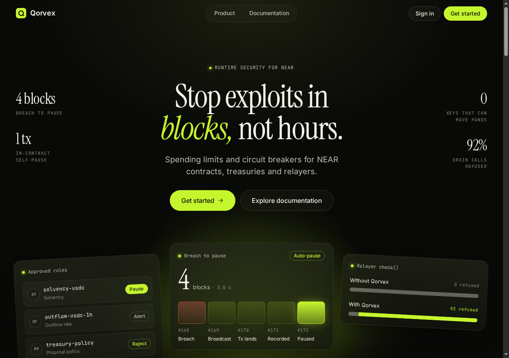</p>

---

## 1. Overview

**The problem.** Two NEAR products lost money in autumn 2026 in ways a basic invariant or spend cap would have caught:

| When | Incident | What a check would have done |
|---|---|---|
| Sep 29 – Oct 1 | [NEAR Intents ghost balances](https://thecoding.substack.com/p/near-intents-ghost-fund-postmortem): a refunded deposit stayed credited, and $3.8M of unbacked balances were withdrawn over about 40 hours before anyone noticed. | The solvency rule `owed ≤ held` fails on the first ghost credit. |
| Oct 19 | [Trezu sponsor relayer drained twice](https://github.com/NEAR-DevHub/trezu/issues/1871): the relayer paid for up to 200 `storage_deposit` calls per proposal into an attacker's token. | A per-beneficiary budget refuses the calls before the relayer signs. |

NEAR cross-contract calls are asynchronous, so a contract cannot check its real token balances inside one transaction. Catching this takes an outside watcher that is always on, and every team has had to build its own.

**What Qorvex is.** A hosted service with a small on-chain footprint:

- **Prevent:** the `qorvex-guard` Rust crate caps outflows inside the contract and pauses it *in the same transaction* when its own accounting breaks. Relayers ask Qorvex before paying for any sponsored action.
- **Detect and stop:** a watcher evaluates rules on every block that touches a protected contract, confirms with a fresh read, and pauses through an on-chain **guardian contract**, using a NEAR function-call key limited to `guardian.pause`.
- **Verify:** public status pages show each check with the exact RPC read behind every number, so depositors can verify backing themselves.

**Who it is for**

| User | What they get |
|---|---|
| Protocol and treasury teams (Intents-style ledgers, DeFi vaults, Sputnik DAOs) | Rules drafted by AI and approved by the team, automatic pause, incident evidence and recovery steps |
| Relayer and gas-sponsor operators | `check()` before every sponsored transaction, budgets per beneficiary, a decision log |
| Depositors | A public page that answers "is this protocol still fully backed?" |

**Why it is safe to install.** Qorvex can pause and nothing else. It cannot unpause, change limits or move funds. The AI drafts rules and explains incidents; the team approves every rule, and deterministic code decides when to pause.

---

## 2. Key features

| Feature | What it does | Status |
|---|---|---|
| **In-contract guard** (`qorvex-guard`) | Per-token, per-window outflow caps; a self-accounting check that pauses the contract inside the transaction that would make it insolvent | ✅ Implemented · unit and sandbox tested |
| **Watcher + guardian** | Streams blocks, evaluates solvency and outflow-rate rules, confirms with a direct read, pauses through the guardian. Adapters for qorvex-guard, near-plugins `Pausable` and custom pause methods; per-target pause scopes; at most one automatic pause per hour unless the contract's council allows another | ✅ Implemented · sandbox tested · deployed on testnet |
| **Proposal firewall** | A reject-only Sputnik DAO role votes down proposals that break the treasury policy; it can never approve | ✅ Implemented · sandbox tested |
| **Relayer `check()`** | Decided on the server against one shared spend history, so all relayer instances share one budget; zero-dependency client `@qorvex/relayer-sdk` | ✅ Implemented · unit tested |
| **AI rule drafting** | Open-weight Qwen models on NEAR AI Cloud draft rules from the source, ABI, view methods, live state and recent receipts; every draft is checked against the chain and backtested before anyone sees it | ✅ Implemented · recorded responses committed |
| **Incident explanations** | Written by AI after the pause lands: what broke, by how much, which receipts to check | ✅ Implemented |
| **Contract check** | Paste a contract id, no account needed: read-only probes show what Qorvex can watch, whether it can pause, who controls it and what they would sign | ✅ Implemented · live |
| **Public status page** | A security summary with *confirmed / failed / absent / unavailable / unknown* states, block references and freshness; raw reads with a `curl` for each; the guardian registration is read by the visitor's own browser | ✅ Implemented |
| **Multi-tenant console** | Sign in with a NEAR wallet (NEP-413) or email; workspaces with owner, admin, responder and viewer roles; on-chain authority claims; API keys; an append-only activity log | ✅ Implemented · unit tested |
| **Incident response** | Evidence with reproducible reads, a measured timeline, the pause transaction, and recovery transactions prepared for the owner to sign | ✅ Implemented |

---

## 3. Screenshots & demo

**Live demo (NEAR testnet):** https://qorvexbackend-production.up.railway.app

| | |
|---|---|
| **Contract check** on testnet, no account: the deployed ledger is recognised as embedding qorvex-guard and registered with the guardian (level 3)<br> | **Public status page**: the security summary first, the evidence one click away<br>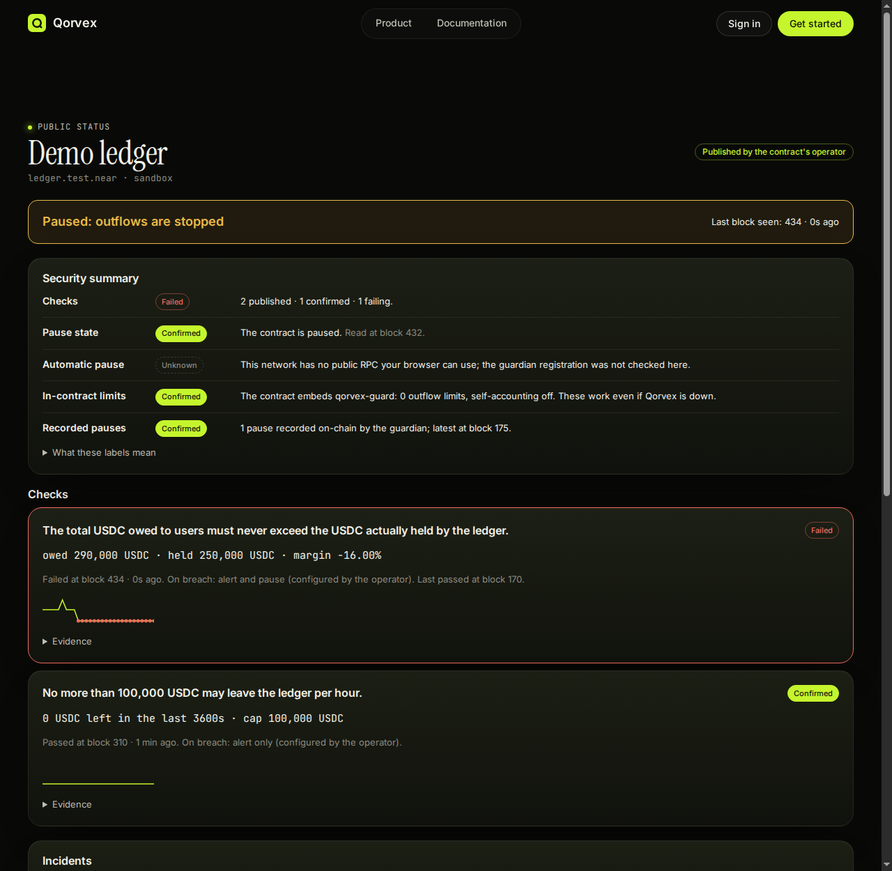 |
| **Overview**: contract states from evidence, monitoring health, setup to-dos, recent incidents<br>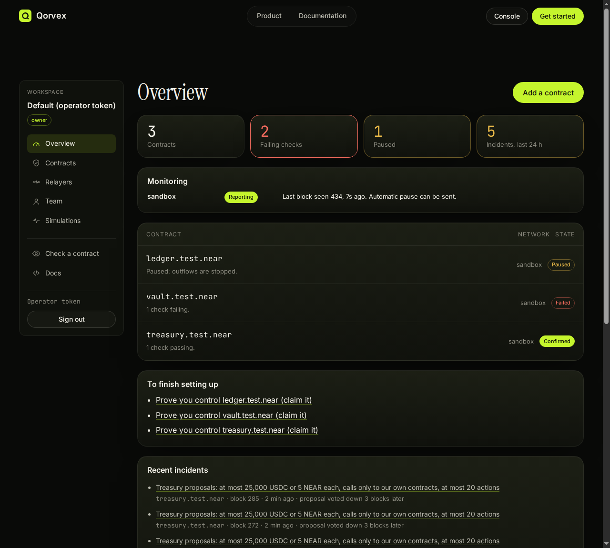 | **Incident**: paused within seconds of the breaking block, with evidence, timeline and explanation<br>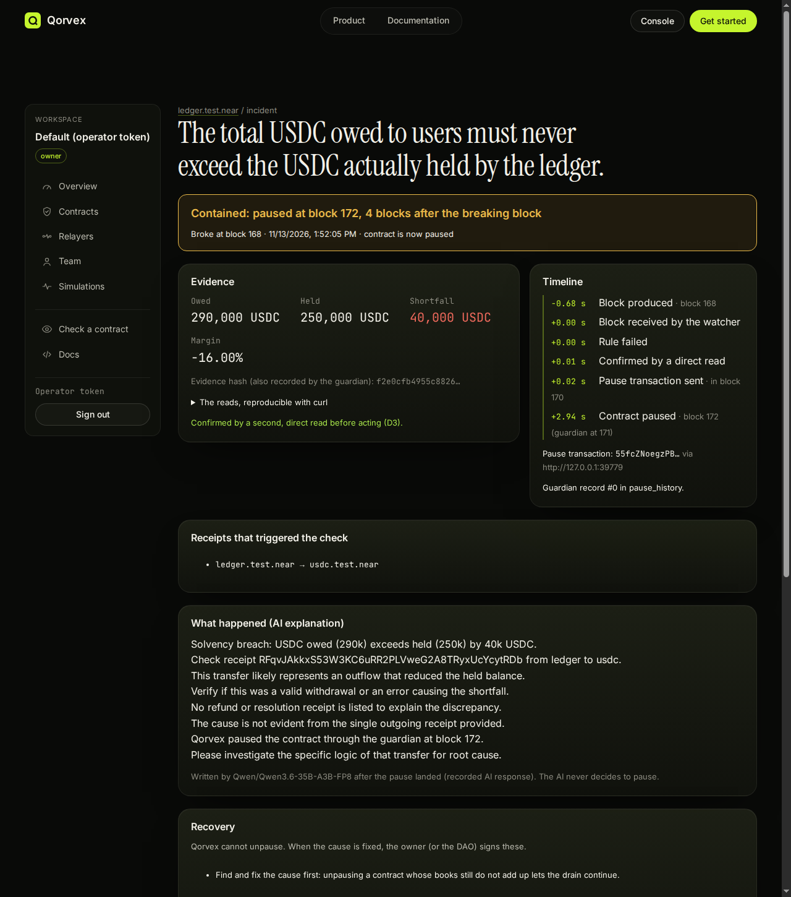 |
| **Rules**: AI drafts, templates, live values, backtests and approval<br>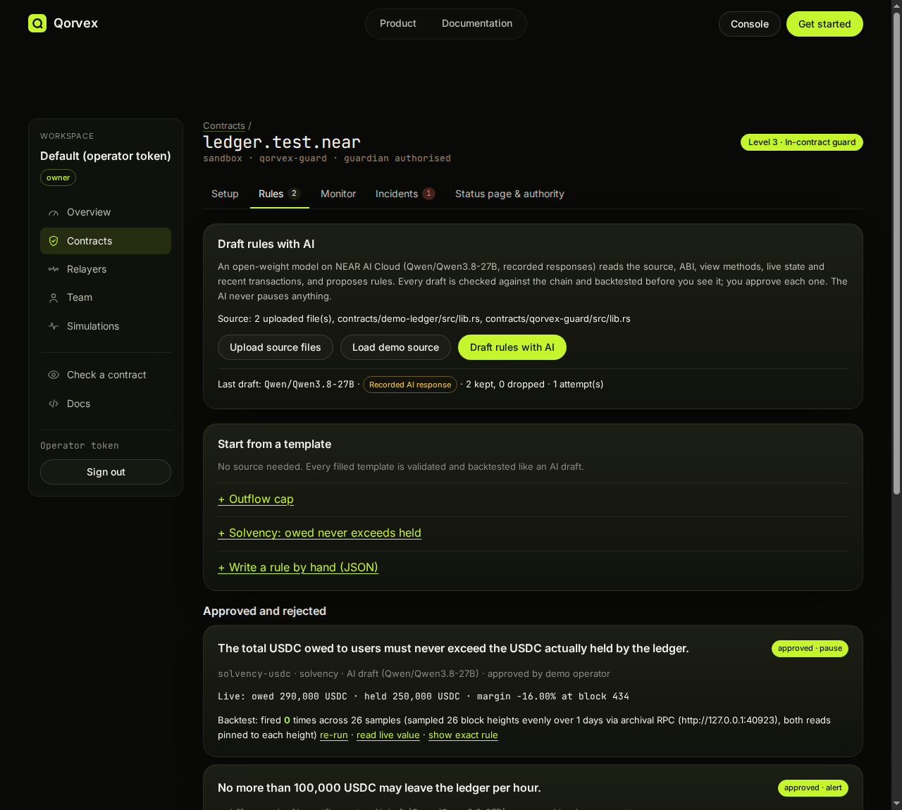 | **Monitor**: live owed, held and margin per rule<br>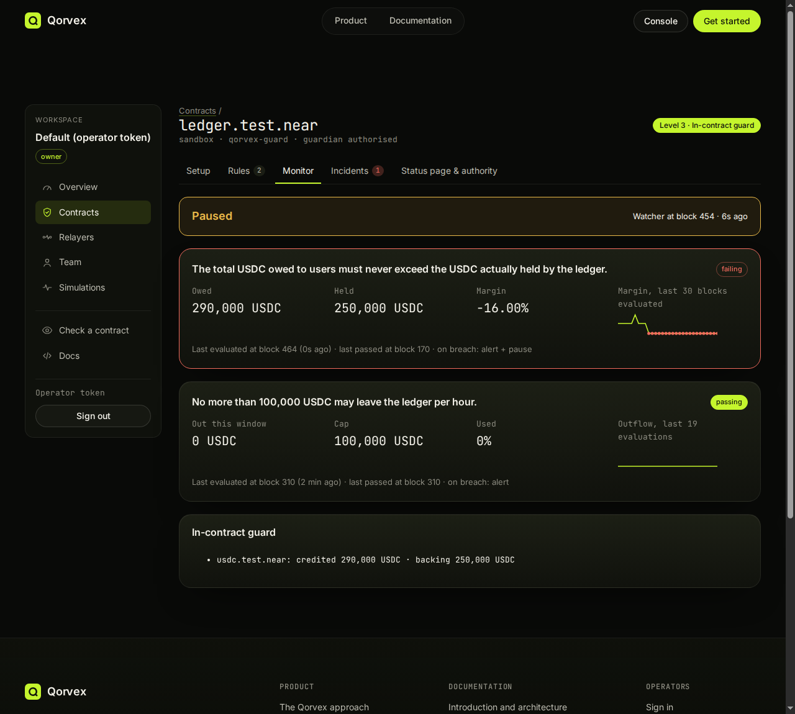 |
| **Simulations** (local demo): replay the Intents bug, the vault self-pause, the Trezu drain and the DAO firewall<br>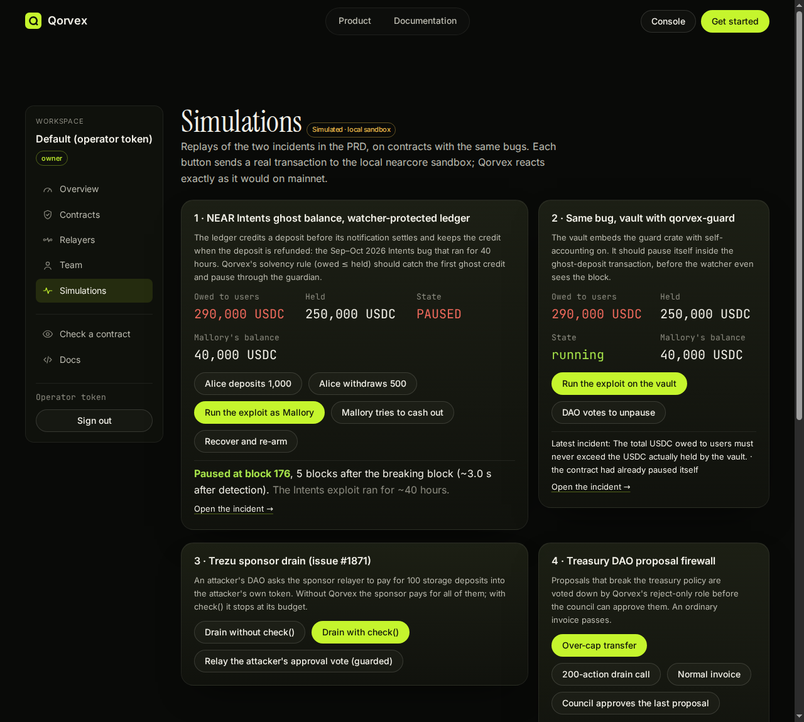 | **Relayer**: budgets and the decision log; 92 of 100 drain attempts refused<br>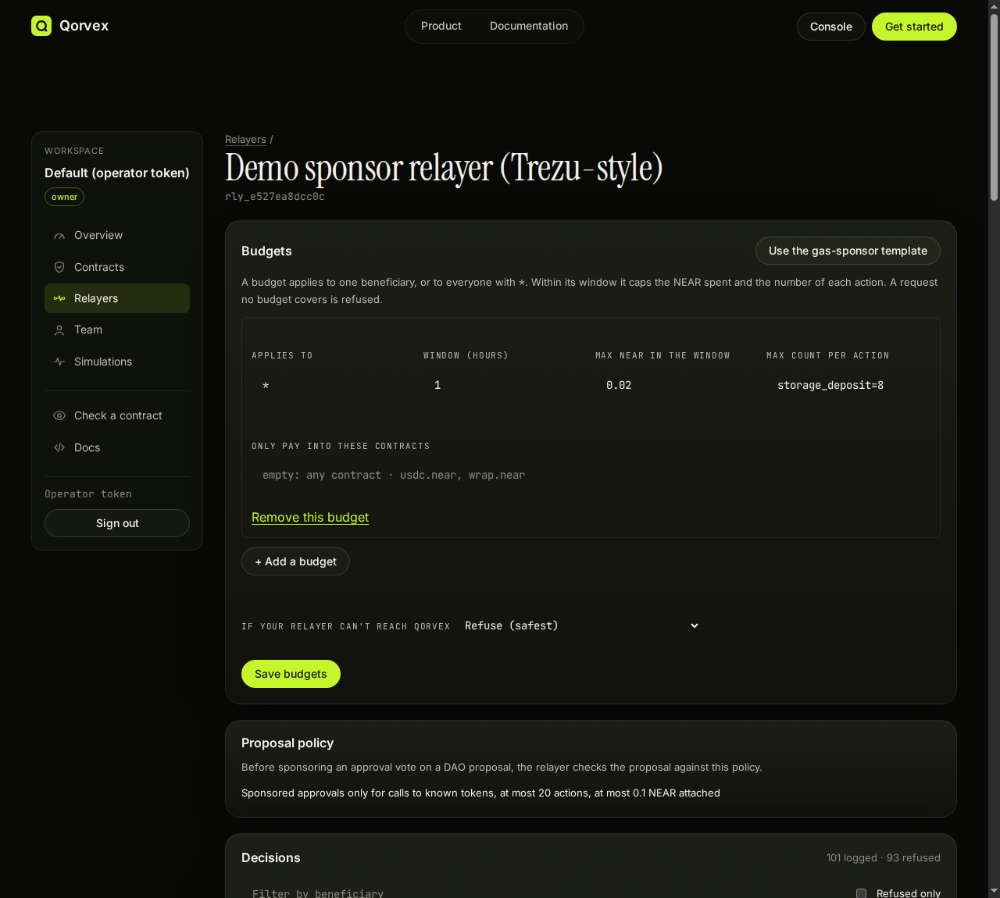 |
| **Team**: members, invitations, API keys, activity log<br>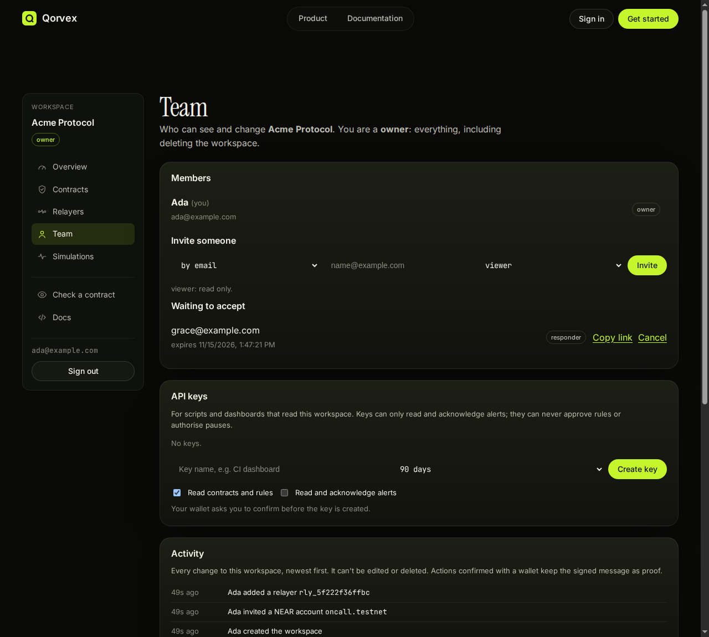 | |

Screenshots are captured from the running application: the local sandbox demo, and the hosted testnet app for the contract check.

---

## 4. Navigation guide

**Public pages** (no account)

| Page | Route | Purpose |
|---|---|---|
| Landing | `/` | What Qorvex does; **Get started** opens the contract check |
| Contract check | `/check`, `/c/:network/:contract` | Read-only detection: protection level, controller, recommended path, rules that fit, and **claim and protect** |
| Status page | `/status/:id` | Public security summary and evidence for a published contract |
| Docs | `/docs` | Product and integration documentation |
| Sign in | `/sign-in` | NEAR wallet (testnet by default), email, or the self-hosted operator token |
| Accept invite | `/accept-invite/:id` | Join a workspace from an invitation link |

**Console** (signed in; left sidebar)

| Section | Route | Purpose |
|---|---|---|
| Overview | `/app` | Contracts, failing checks, pauses, monitoring health, to-dos, recent incidents |
| Contracts | `/app/contracts` → `/app/contracts/:id` | Tabs: **Setup** (detected → control verified → guardian authorised → rules), **Rules**, **Monitor**, **Incidents**, **Proposals** (DAOs), **Status page & authority** |
| Incident | `/app/incidents/:id` | Evidence, timeline, pause transaction, explanation, recovery transactions |
| Relayers | `/app/relayers` → `/app/relayers/:id` | Create a relayer (token shown once, with an SDK snippet), budgets, decision log |
| Team | `/app/team` | Members and roles, invitations, API keys, activity log |
| Simulations | `/app/simulations` | Local sandbox: run the replays |

**Typical flow:** check a contract → sign in → claim it with a signature from the account that controls it → authorise the guardian (a wallet transaction, or a DAO proposal) → approve rules → publish the status page.

---

## 5. Quick evaluation guide

### A. Hosted app (about 3 minutes, nothing to install)

1. Open **https://qorvexbackend-production.up.railway.app** and press **Get started**.
2. Keep `testnet`, enter **`ledger.proudrobe4711.testnet`** and press **Check**.
   → It is recognised as embedding qorvex-guard, **registered with the guardian (level 3)** and controlled by `owner.proudrobe4711.testnet`. Open **How we know** to see each read-only probe.
3. **Sign in → Email → Create an account**, then name a workspace.
   → You land on **Overview**, with Contracts, Relayers and Team in the left sidebar.
4. **Relayers → Add relayer**: the token is shown once with an SDK snippet. Then **Set the budget → Use the gas-sponsor template**.
5. **Team → Invite someone** by email: you get an invitation link to share.

### B. Full exploit replays, locally (about 5 minutes)

```bash
npm ci
npm run demo
```

The first run downloads the nearcore sandbox binary (about 90 MB). When the `Qorvex console:` line appears, open `http://localhost:8787/sign-in`, choose **Operator token** and paste the token printed on that line. Then:

1. **Contracts → Add a contract** → network `sandbox` → `ledger.test.near` → **Check** → **claim and protect it**.
2. **Rules → Load demo source → Draft rules with AI**, then approve the solvency rule as **alert + auto-pause**.
3. **Setup → Sign with the sandbox owner key** (local sandbox accounts are signed by the demo) → level 3.
4. **Simulations → Run the exploit as Mallory**: owed rises above held, then **PAUSED** within a few blocks. **Mallory tries to cash out** → rejected.
5. Open the incident: evidence, timeline, pause transaction, explanation and recovery steps.

To run the whole scripted scenario without clicking: `npm run demo -- --auto` (add `--exit` to stop afterwards). Its output is shown in [Testing & verification](#9-testing--verification).

---

## 6. Architecture

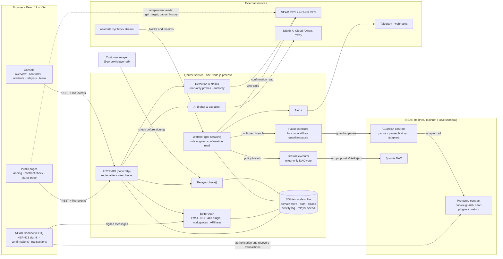

**From breach to pause**, as implemented in the watcher, the pause executor and the guardian:

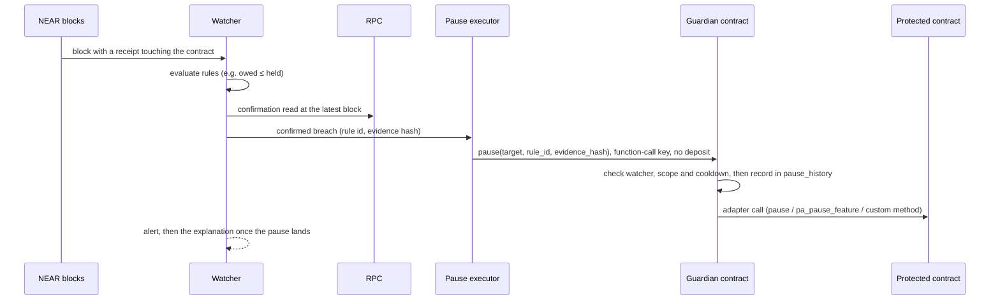

**Trust boundaries**

| Component | Can | Cannot |
|---|---|---|
| Qorvex watcher key | Call `guardian.pause` | Call any other method, attach deposits, unpause, move funds |
| Guardian contract | Forward a pause through the registered adapter and record it | Unpause, change limits, move funds |
| AI models | Draft rules, explain incidents | Approve rules, trigger pauses |
| Workspace members | What their role allows; approving a pausing rule, claiming a contract and creating an API key require a fresh wallet signature | Trigger pauses on a contract unless their workspace holds verified authority from the guardian's council |

---

## 7. Tech stack & integrations

| Layer | Technology | Role |
|---|---|---|
| Smart contracts | Rust, **near-sdk 5.29**, near-contract-standards, cargo-near | `qorvex-guard` crate, guardian contract, demo ledger and NEP-141 token |
| Backend | **Node.js ≥ 22** (`node:http`, `node:sqlite`), TypeScript via tsx | API, watcher, executors, rule engine, backtests |
| NEAR client | **near-kit 0.20.2** | Transactions, NEP-413 verification, local sandbox |
| Accounts | **Better Auth 1.7.22** with its organization and `@better-auth/api-key` plugins | Sessions, email sign-in, workspaces and roles, API keys; NEAR sign-in is an in-repo NEP-413 plugin |
| Frontend | **React 19**, react-router 7, Vite | Public pages and console |
| Wallets | **NEAR Connect** (`@hot-labs/near-connect` 0.12.0, by HOT) | Wallet selection, message signing, transactions (loaded on demand) |
| AI | **NEAR AI Cloud** (OpenAI-compatible API; open-weight models served in TEEs) | `Qwen/Qwen3.8-27B` drafts rules; `Qwen/Qwen3.6-35B-A3B-FP8` explains incidents |
| Chain data | NEAR RPC (FastNEAR, dRPC, Intea), near.org archival RPC, **neardata.xyz** | Reads, confirmation, backtests, block stream |
| On-chain integrations | **Sputnik DAO v2.3.1** (vendored wasm), **near-plugins** `Pausable`/ACL, NEP-141, NEP-330 | DAO firewall and DAO-signed authorisation; automatic pause for near-plugins contracts; token balances; source metadata |
| Alerts | Telegram Bot API, HMAC-signed webhooks | Incident notifications |
| Hosting | Docker, **Railway** | Hosted demo |
| Testing | vitest, cargo test, near-kit sandbox | Unit, end-to-end and contract tests |

---

## 8. Getting started

**Prerequisites:** Node.js 22 or newer (tested with 24.21), Linux or macOS on x86_64/arm64, about 1 GB of free RAM. Rust is only needed to rebuild the contracts; the built wasm is committed in [`contracts/wasm/`](contracts/wasm/).

```bash
git clone https://github.com/Jayy4rl/Qorvex.git
cd Qorvex
npm ci
npm run demo            # local sandbox with the demo contracts; console on http://localhost:8787
```

**Watch testnet instead of the local sandbox:**

```bash
cp .env.example .env    # fill in the values you need
QORVEX_NETWORKS=testnet npm start
```

**Main settings** (all listed in [`.env.example`](.env.example); secrets are read from environment variables only):

| Variable | Purpose |
|---|---|
| `PUBLIC_URL` | Public address of the app; also the NEP-413 `recipient` wallets sign for (derived from `RAILWAY_PUBLIC_DOMAIN` on Railway) |
| `QORVEX_NETWORKS` | Networks to watch: `testnet`, `mainnet`, `sandbox` |
| `QORVEX_ADMIN_TOKEN` | Operator token for the single-tenant "default" workspace |
| `QORVEX_SINGLE_TENANT` | `true` (default) enables the operator token; `false` uses user accounts only |
| `QORVEX_AUTH_SECRET` | Signs session cookies (generated into the data folder when unset) |
| `QORVEX_<NET>_GUARDIAN`, `QORVEX_<NET>_WATCHER_ACCOUNT`, `QORVEX_<NET>_WATCHER_KEY` | Guardian contract and the pause-only watcher key for each network |
| `QORVEX_AI_MODE`, `NEARAI_API_KEY` | `replay` (default: recorded responses, no key needed), `live` or `record` |
| `TELEGRAM_BOT_TOKEN`, `TELEGRAM_CHAT_ID`, `QORVEX_WEBHOOK_URL`, `QORVEX_WEBHOOK_SECRET` | Alerts |
| `FASTNEAR_API_KEY` | Higher block-stream rate limits |

**Other commands**

| Command | What it does |
|---|---|
| `npm run dev:web` | Frontend with hot reload on :5173 (proxies the API to :8787) |
| `npm run deploy:testnet` | Deploys the guardian, demo token and ledger to testnet (prints the plan; `--yes` signs) |
| `npm run replay:testnet -- state` | Reads the testnet ledger; `ghost --yes` replays the exploit there |
| `npm run build:contracts` | Rebuilds the wasm (needs Rust and cargo-near) |

---

## 9. Testing & verification

| Suite | Command | Result (2026-11-13) |
|---|---|---|
| Typecheck, backend unit, frontend, build | `npm run check` | **97** backend unit tests (9 files) and **32** frontend tests (4 files) pass; build succeeds |
| End-to-end on a local nearcore sandbox | `npm run test:e2e` | **16** tests pass (about 4 minutes) |
| Contracts | `npm run test:contracts` | **48** tests pass: guardian 28, qorvex-guard 13, demo ledger 7 |

The suites cover, among others:
- every workspace route called as another workspace's user, with no data returned;
- NEP-413 sign-in with real ed25519 keys: wrong recipient, function-call keys, replayed nonces, RPC outages, and wallet signature formats;
- the pause gate: only the workspace holding the contract's official record, proven by the guardian's council, can pause;
- relayer budgets under concurrent checks (6 parallel requests against a cap of 3 allow exactly 3);
- the watcher key being unable to call anything except `pause`.

**Output of `npm run demo -- --auto`** (local sandbox, excerpt):

```text
Demo ledger: AI drafted 2 rule(s) with Qwen/Qwen3.8-27B (replay): solvency-usdc, outflow-usdc-1h
Demo ledger: approved solvency-usdc as pause (backtest: 0 fires over 27 samples)
Demo ledger: guardian verified=true (contract guardian guardian.test.near, registered council owner.test.near, watcher key scope ok=true)
Replay: NEAR Intents ghost-balance bug on the ledger (deposit with a failing notification)
  watcher: breach at block 173, ledger paused at block 177 = 4 blocks later, 2.9 s after detection (NEAR Intents: ~40 hours unnoticed)
  timeline: block 173 produced -> received +746 ms -> evaluated +6 ms -> confirmed+signed +10 ms -> broadcast; tx in block 175, guardian receipt in 176, target paused in 177
  attacker withdraw of the ghost balance: rejected (qorvex-guard: contract is paused ...)
Replay: same bug against the vault (qorvex-guard self-accounting on)
  vault paused in the deposit transaction itself (...): self-accounting: credited 290000000000 > backing 250000000000 for usdc.test.near
Replay: Trezu sponsor drain (issue #1871): 100 sponsored storage_deposit calls into the attacker's token
  without Qorvex: sponsored 100, sponsor balance 0.6 NEAR -> 0.40575 NEAR
  with Qorvex check(): sponsored 8, refused 92, sponsor balance 0.6 NEAR -> 0.50347 NEAR
Insider transfer (requestor asks for 200,000 USDC): mallory.test.near submits proposal #2
  Qorvex voted VoteReject 3 blocks after submission -> proposal Rejected
Qorvex holds one key: function-call, receiver guardian.test.near, methods ["pause"].
```

**The incident in the screenshot above** (ledger, local sandbox): breach detected at block 168, pause transaction `55fcZNoe…e3cW` landed and the ledger paused at block 172, which is 4 blocks and 2.9 s after detection. Its explanation, written by Qwen/Qwen3.6-35B-A3B-FP8 on NEAR AI Cloud after the pause landed:

```text
Solvency breach: USDC owed (290k) exceeds held (250k) by 40k USDC.
Check receipt RFqvJAkkxS53W3KC6uRR2PLVweG2A8TRyxUcYcytRDb from ledger to usdc.
This transfer likely represents an outflow that reduced the held balance.
Verify if this was a valid withdrawal or an error causing the shortfall.
No refund or resolution receipt is listed to explain the discrepancy.
The cause is not evident from the single outgoing receipt provided.
Qorvex paused the contract through the guardian at block 172.
Please investigate the specific logic of that transfer for root cause.
```

**On NEAR testnet** (anyone can verify):

| What | Account or transaction |
|---|---|
| Guardian contract | [`guardian.proudrobe4711.testnet`](https://testnet.nearblocks.io/address/guardian.proudrobe4711.testnet) |
| Demo ledger (embeds qorvex-guard) | [`ledger.proudrobe4711.testnet`](https://testnet.nearblocks.io/address/ledger.proudrobe4711.testnet) |
| Demo token (NEP-141) | [`usdc.proudrobe4711.testnet`](https://testnet.nearblocks.io/address/usdc.proudrobe4711.testnet) |
| Guardian authorised on the ledger (`set_guardian`; the ledger registers itself with the guardian) | [`2LyBZhfHiPp1um43JwMS1ZTe7bx5xY8QnZm2c7Vmc2zs`](https://testnet.nearblocks.io/txns/2LyBZhfHiPp1um43JwMS1ZTe7bx5xY8QnZm2c7Vmc2zs) |

Check it yourself: `guardian.proudrobe4711.testnet` → `get_target({"target":"ledger.proudrobe4711.testnet"})` returns the registration (adapter `QorvexGuard`, council `owner.proudrobe4711.testnet`, scope `ALL`).

---

## 10. Deployment

**Hosted demo:** https://qorvexbackend-production.up.railway.app

One Railway service built from the repository's [`Dockerfile`](Dockerfile) and [`railway.json`](railway.json): one replica, health check on `/api/health`, a persistent volume at `/data` for the SQLite database, watching **NEAR testnet**.

To deploy your own:

1. Create a Railway project from the repository (root directory: repository root; builder: Dockerfile; no custom start command).
2. Attach a volume at `/data` and generate a public domain.
3. Set `QORVEX_ADMIN_TOKEN` and `QORVEX_AUTH_SECRET` to random strings (for example `openssl rand -hex 32`), then add the three `QORVEX_TESTNET_*` values printed by the contract deploy.

**Contracts on testnet:** `npm run deploy:testnet` prints every account it will create, its balance and the total (about 7.4 testnet NEAR, almost all of it refundable storage staking), and stops if the account cannot cover it; `--yes` signs. Keys are saved to the git-ignored `data/testnet/` folder as each account is created.

Any Docker host works the same way:

```bash
docker build -t qorvex .
docker run -p 8787:8787 -v qorvex-data:/data -e QORVEX_ADMIN_TOKEN=... qorvex
```

---

## 11. Known limitations

| Area | Current scope |
|---|---|
| Pause latency | 4 blocks (about 3 s) from the breaking block to the pause on the local sandbox, against a 3-block target; the extra block comes from polling the block stream, and a NEAR Indexer node is the path to 3. |
| Mainnet backtests | The 30-day backtest on mainnet NEAR Intents needs an archival RPC endpoint without rate limits (`QORVEX_MAINNET_ARCHIVAL_RPC`). |
| Email | Invitations are shared as links and password-reset emails are written to the server log; an email provider is not configured. |
| Alerts | Telegram and webhook destinations are configured per server, not per workspace. |
| Local sandbox | Wallets connect to testnet and mainnet; on the local sandbox the demo signs with its own accounts. |
| Scale | One server process (the working set is held in memory); one guardian and one watcher key per network serve all workspaces. |
| Roadmap | Embeddable status badge and depositor alerts, watchers running in a TEE, multi-watcher quorum, billing. |

The demo ledger carries the "refund after credit" bug on purpose, for the replays: it is not for real funds.

---

## 12. Related hackathon project

**[OTHER PROJECT NAME] — [OTHER PROJECT URL]**

---

<sub>MIT licensed: see [LICENSE](LICENSE). Libraries are listed in [Tech stack & integrations](#7-tech-stack--integrations); development used Claude Code.</sub>
